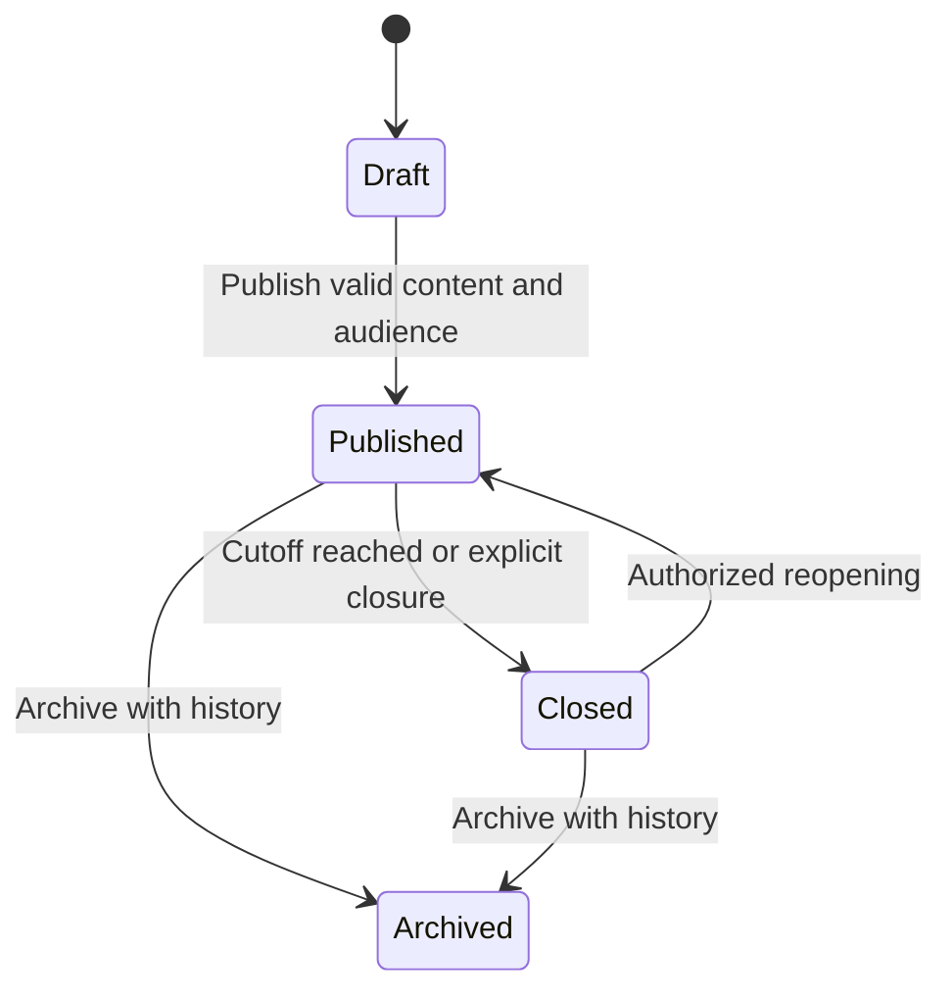
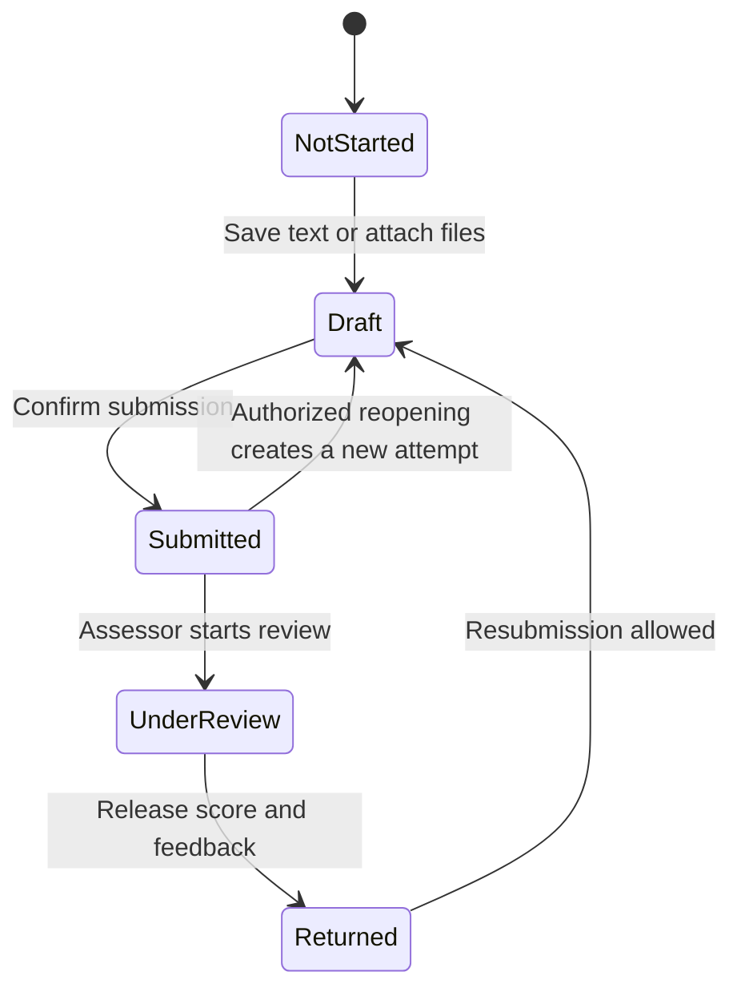

# Farida LMS domain and workflow design

Status: research-backed implementation specification. This describes the target behavior, not a claim that the current code implements it. The [rewrite tracker](rewrite-tracker.md) records implementation and verification separately.

## Evidence and implications

Moodle assigns permissions through roles in a context. Canvas represents enrollments individually, including multiple enrollments for the same user, and associates observers with particular students. These support a school model in which a person's identity is distinct from their school responsibilities. Farida LMS must support a teacher who is also a parent without treating their class access and family access as interchangeable. [Moodle roles](https://docs.moodle.org/en/Roles_and_permissions), [Canvas enrollments](https://developerdocs.instructure.com/services/canvas/resources/enrollments), [Canvas observees](https://developerdocs.instructure.com/services/canvas/resources/user_observees).

OWASP recommends checking authorization on every request and using resource attributes and relationships where role checks alone are insufficient. Farida LMS therefore evaluates the action, school, record relationship, active assignment of responsibility, and workflow state together. UI visibility is derived from the same policy vocabulary; it is never the security boundary. [OWASP authorization guidance](https://cheatsheetseries.owasp.org/cheatsheets/Authorization_Cheat_Sheet.html).

Moodle distinguishes when submissions open, when they become late, and when they stop being accepted. Its assignment settings also distinguish drafts from submitted work and support additional attempts. Canvas exposes submission history and indicates when a grade refers to an earlier submission. Farida LMS needs separate assignment availability, submission attempts, and grade release states. [Moodle assignment settings](https://docs.moodle.org/en/Assignment_settings), [Canvas submissions](https://developerdocs.instructure.com/services/canvas/resources/submissions).

## Entities and ownership

```mermaid
erDiagram
    SCHOOL ||--o{ MEMBERSHIP : contains
    MEMBERSHIP ||--o{ ROLE_ASSIGNMENT : holds
    ACCESS_ROLE ||--o{ ROLE_ASSIGNMENT : defines
    SCHOOL ||--o{ SCHOOL_YEAR : organizes
    SCHOOL_YEAR ||--o{ TERM : contains
    SCHOOL_YEAR ||--o{ CLASS : contains
    CLASS ||--o{ SUBJECT_OFFERING : teaches
    SUBJECT ||--o{ SUBJECT_OFFERING : identifies
    MEMBERSHIP ||--o{ TEACHING_ASSIGNMENT : teaches
    SUBJECT_OFFERING ||--o{ TEACHING_ASSIGNMENT : staffed_by
    STUDENT ||--o{ ENROLLMENT : attends
    CLASS ||--o{ ENROLLMENT : includes
    MEMBERSHIP ||--o{ GUARDIAN_LINK : observes
    STUDENT ||--o{ GUARDIAN_LINK : connected_to
    SUBJECT_OFFERING ||--o{ ASSIGNMENT : owns
    ASSIGNMENT ||--o{ ASSIGNMENT_RECIPIENT : targets
    STUDENT ||--o{ ASSIGNMENT_RECIPIENT : receives
    ASSIGNMENT_RECIPIENT ||--|| SUBMISSION : tracks
    SUBMISSION ||--o{ SUBMISSION_ATTEMPT : preserves
    SUBMISSION_ATTEMPT ||--o{ ASSESSMENT : reviewed_with
    SUBMISSION_ATTEMPT ||--o{ FILE_LINK : includes
    ASSIGNMENT ||--o{ FILE_LINK : supplies
    PRIVATE_FILE ||--o{ FILE_LINK : attached_as
```

The diagram is conceptual. School-owned records reside in the school's database; the control database holds the school registry and authentication routing. An identifier supplied by the browser never selects a different school database.

| Entity                  | Meaning and invariant                                                                                                                                                                                                                                          |
| ----------------------- | -------------------------------------------------------------------------------------------------------------------------------------------------------------------------------------------------------------------------------------------------------------- |
| Identity and membership | Login identity and an active relationship with a school are separate concerns. School-local accounts remain isolated; matching email addresses never merge accounts or guardianships automatically. A membership can hold several contextual responsibilities. |
| Student                 | An educational record that may exist without a login. At most one active student identity link per school membership; unlinking an account preserves educational history.                                                                                      |
| School year and term    | Date-bounded academic organization. Terms belong to one year. Switching the active year changes the working context, not historical ownership.                                                                                                                 |
| Class                   | A roster/homeroom in a particular year. A class name can recur in another year. Grade and room are attributes, not authorization scopes.                                                                                                                       |
| Subject offering        | A subject taught to a class in a year. It is the context for teaching assignments, coursework, assessment and lesson scheduling.                                                                                                                               |
| Enrollment              | A dated relationship between a student and a class. Transfers end one relationship and start another; they do not move submitted work or delete attendance. Membership rules distinguish homeroom placement from optional course enrollment.                   |
| Teaching assignment     | A dated teacher-to-offering responsibility. Homeroom responsibility is separate and does not imply authority to grade every subject. Substitution has explicit scope and expiry.                                                                               |
| Guardian link           | An administrator-verified relationship to one student, with permitted purposes and validity. A contact phone number, surname, email, or emergency-contact record does not grant portal access.                                                                 |
| Role assignment         | A named permission set assigned to a membership in an explicit school, class, offering, or student context. Several assignments may coexist. Each grant carries its own scope; grants from unrelated contexts cannot be combined to widen access.              |
| Assignment recipient    | The student audience for a published assignment, with individual availability/extension overrides where needed. Publishing resolves the audience; roster changes do not silently erase existing recipients or attempts.                                        |
| Submission and attempt  | One aggregate per assignment recipient. Mutable drafts carry a revision. A submitted attempt is immutable and has an incrementing attempt number, actor, submission time, content, and attachment references.                                                  |
| Assessment              | Feedback and score refer to a specific attempt. Draft assessment is distinct from released feedback. Term grades have an explicit calculation or manual-entry policy and do not silently mirror one assignment score.                                          |
| Private file            | A verified object with tenant, owner, size, checksum, media type and processing state. Links identify its allowed purpose. Knowing a file ID never grants a download.                                                                                          |

## Academic dates

Every school year, term and teaching week date is an inclusive date in the school's own time zone: a year that ends on 30 June includes 30 June. Terms are the grading periods; grades name the term they belong to, and terms must sit inside their year without overlapping. Teaching weeks run from Sunday to Saturday, clipped to the year, and cover every day of it: a new year receives its weeks when it is created, an extended year has its last week completed and new weeks appended, and a year receives weeks before it becomes the default if it had none. Existing weeks are never renumbered, because assignments point at them. Placements are the one exception to inclusive ends: an enrollment's `until` is the first day it no longer applies, so rollover ends a placement on the day after the source year. An adapter for a standard that uses exclusive end dates for years or terms must convert explicitly at its boundary.

## Authorization rules

The account's preferred workspace controls navigation only. Authorization requires an active membership and at least one applicable grant for the requested action and resource. Suspended memberships and revoked relationships deny new requests. Already-issued download credentials must have a short, documented lifetime; immediate revocation requires an authenticated download path.

Every capability declares its legal scopes. For example, grading is valid within an offering; managing school branding is school-scoped. A guardian's coursework access is student-scoped and requires a live guardian link. A school-level academic administrator may receive broader academic grants explicitly. Platform operations access does not automatically include educational records.

An administrator may create named roles, inspect their permissions, assign them in supported scopes, and review changes. Updating a role is a revision-checked transaction that records before/after values and the acting membership. Assigning a role cannot grant a capability or scope beyond the actor's delegation authority. Concurrent changes must not remove the final active owner or allow self-escalation. Protecting this invariant requires a shared transaction lock for owner/role assignment changes, membership suspension, and account changes affecting access.

Built-in roles are initial templates, not hardcoded bypasses. Custom roles do not depend on comparing their display names with "admin" or "teacher". A role editor must show affected people, scope, changed permissions, and the reason a protected permission cannot be changed. It must not expose controls that the backend cannot safely enforce.

School roles live in `access_roles`: the four built-in roles are materialised from the static matrix until an administrator edits them, and custom roles carry a fixed base role and a permission list. A person holds at most one assigned role through `user_access_roles`; without one they carry the built-in role for their base role. Effective permissions are computed on every protected request from that assignment, never from the client. Saving or assigning a role requires `access:manage`, is revision-checked, runs under one advisory lock per school, and is refused when it would grant a capability the actor does not hold, remove the actor's own `access:manage`, or leave the school with nobody holding it. Every edit and assignment is recorded in `access_changes` with the acting user and before/after values. Relationship scope (which classes, students and people a person may see) is derived from enrolments, teaching responsibilities and guardian links, separately from the permission list, so a wider role never widens a person's reach beyond their relationships.

| Action                                   | Default authorized actor and scope                           | Additional condition                                                                                                                           |
| ---------------------------------------- | ------------------------------------------------------------ | ---------------------------------------------------------------------------------------------------------------------------------------------- |
| Configure school and academic year       | School administrator with the specific management capability | Validate dates and preserve prior-year records.                                                                                                |
| Invite, suspend or edit accounts         | Authorized people administrator in this school               | Access changes require separate delegation authority; protect the final owner.                                                                 |
| Manage guardians and enrollment          | Authorized registrar in this school                          | Validate both ends of each relationship, effective dates and revision.                                                                         |
| Create or change classes and offerings   | Academic administrator                                       | Referenced teachers and subjects belong to this school; preserve history.                                                                      |
| Read a class roster                      | Assigned teacher or academic administrator                   | Match class/offering and effective teaching dates.                                                                                             |
| Author and publish assignments           | Assigned subject teacher or delegated academic administrator | Match the offering; publishing requires valid audience, instructions, policy and ready files.                                                  |
| Read instructions and download materials | Assigned teacher, targeted student, or linked guardian       | Published and visible to the recipient; archived access is read-only.                                                                          |
| Save or submit student work              | Targeted student                                             | Open submission window, allowed attempt, ready files and matching revision.                                                                    |
| Help a child upload or submit            | Explicitly authorized guardian                               | School policy and assignment permit assisted submission; record guardian as the actor and student as the learner. Never impersonate the child. |
| Review, grade or return work             | Subject teacher or delegated assessor                        | Match offering and attempt; release feedback explicitly.                                                                                       |
| Read grades and feedback                 | Learner or linked guardian                                   | Only released results belonging to that learner.                                                                                               |
| Record daily attendance                  | Homeroom teacher or delegated attendance officer             | Match roster and date; corrections preserve who changed the mark.                                                                              |
| Manage timetable                         | Academic administrator or delegated scheduler                | Reject room, teacher and class collisions over intersecting effective dates.                                                                   |
| Read student health information          | Explicitly authorized health staff and permitted guardian    | Separate capability and minimum necessary fields; ordinary roster access is insufficient.                                                      |
| Send a private message or reply          | Authorized participant within permitted school relationships | Recipients are server-validated; reply access follows actual thread participation.                                                             |
| Publish newsletters or school events     | Authorized school communicator                               | Audience, publication state, dates, content and attachments are valid.                                                                         |
| Change roles and assignments             | Authorized access administrator                              | No escalation, protected-owner invariants, revision check and audit transaction.                                                               |

## Assignment lifecycle



Drafts are visible only to authorized authors/reviewers. Publication does not imply submissions are open: `opensAt`, `dueAt`, and `closesAt` are separate values. The server stores instants and the authoring timezone; the interface states the school timezone. Dates without a time remain date-only values. Due-date overrides apply to an identified recipient and preserve the original policy for audit.

A teacher can edit instructions after publishing, but changes are versioned. Changing maximum score, recipients, accepted submission types, or an already-used grading policy requires an explicit impact check. Existing work must not become invalid or disappear silently. Notifications use a transactional outbox and an idempotent worker; a successful publish must not depend on synchronous email delivery.



The arrows to Draft create a new attempt; they never mutate an earlier submitted snapshot. Late, missing, excused, and extended are policy outcomes, not substitutes for the submission state. The current result indicates which attempt was assessed. Starting a new draft does not present an old score as the grade for the new attempt.

Autosave uses a revision and reports saving, saved, offline, and conflict states. Uploading and saving a draft do not submit it. Submission validates all attached files, captures the document and file references atomically, and uses an idempotency key so retries cannot create duplicate attempts. Grading also checks the selected attempt and assessment revision.

## Public site and blog

A school's marketing site is owned by the school and edited by anyone holding `site:manage`. Site settings are one row per school (tagline in both languages, brand colour, contact details, social links, whether it speaks both languages, on/off); its first language and its logo are the school's own, kept in school settings. Pages carry a slug, a language, a navigation group and order, and a block document; the slug `home` is the landing page and other pages appear under `/pages/{slug}`. Posts carry a slug, a language, a category, a cover image and a Lexical document, and every save appends a revision row that an editor can restore. Publishing snapshots the content; unpublishing removes the snapshot; a draft page can be deleted, a published one cannot until it is unpublished. Visitors never see drafts, scheduled posts before their instant, or anything from a school whose site is off.

## Learning modules

When a school switches e-learning on, teachers holding `assignments:author` build modules for a class and a subject they are responsible for, add ordered lessons made of content, media, quiz and reflection blocks, and publish once every lesson has content. Learners holding `assignments:read` see published modules for their current classes, answer quizzes with immediate feedback, and mark lessons complete once every quiz is answered; `own-work:submit` gates answering and completing, so guardians follow progress without acting for the child. Unpublishing hides the module and its lessons from learners again without discarding their progress.

## Files and rich content

The shared composer stores a versioned, validated document model. Supported nodes and attributes are explicit; a backend renderer produces safe output. Pasted HTML is normalized, unsafe URL schemes and executable embeds are rejected, and attachments are file references rather than arbitrary public URLs. Plain-text extraction serves search, previews and notifications. Existing plain text must migrate without being interpreted as HTML.

Files follow `initiated → uploaded → processing → ready`, with failed/rejected states visible to the owner. Upload initiation binds the object to an authorized school, actor and resource purpose. Completion verifies the object, checksum and size on the server. A file cannot be attached, published or submitted while processing or rejected. Object keys are server-generated and immutable after completion. Cleanup only removes expired unreferenced uploads, never submitted material.

Presigned object-storage URLs are bearer credentials and may be reused until expiry; uploading to an existing key can replace its object. An upload design therefore needs immutable keys, constrained requests and completion checks. Malware inspection and document previews run outside the request process. Private downloads re-check the owning assignment, attempt, message or record. [AWS presigned URL documentation](https://docs.aws.amazon.com/AmazonS3/latest/userguide/using-presigned-url.html).

## Current implementation gaps to close

- `users.role` and role-prefixed route gates still conflate workspace choice with authority. One contextual role assignment per user remains insufficient.
- Grading and authoring now enforce the specific class/subject responsibility; dated substitutions and contextual delegated grants still need implementation.
- Student-scoped assignment, grade, attendance and timetable reads now check their own capabilities. Composite dashboards still need section-level redaction when a capability is revoked.
- Student profile data requires field-level authorization for medical and sensitive contact details. The student record now carries coursework, attendance and released grades as tabs behind their own capabilities, and the class record carries the teaching team, the permitted roster, coursework, per-student attendance and the timetable; the person profile joins a membership to its teaching assignments, visible children and contact details.
- Attempts and assessments now have their own records with explicit release; the submission row mirrors the current released result for lists. Reopening an attempt by an assessor and assessment revision comparison remain open.
- Private files now follow initiate, upload, verify and ready states with authorised downloads. Malware inspection, previews, retention and abandoned-upload clean-up remain open.
- Visibility helpers and current coursework now distinguish active enrollment from ended or future enrollment. Historical enrollment presentation and assignment-recipient snapshots still need implementation.
- Complex editors need routable pages and unsaved-change handling. Table improvements do not constitute a complete assignment workspace.

## Acceptance before release

Tests must exercise a teacher who is also a parent, two teachers of different subjects in the same class, a revoked guardian link, transferred and inactive students, suspended staff, and users in two isolated schools. For every mutation, test allowed access, same-school forbidden access, cross-school IDs, stale revisions, retries, and workflow violations.

Browser acceptance includes teacher publication with an attachment, parent download, student draft upload and confirmed submission, teacher feedback release, authorized resubmission, and preserved earlier attempts. Repeat the essential journeys on mobile and desktop in English and Arabic. Access changes must be observable on the next request without signing out.
